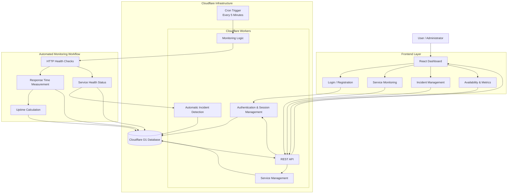

# OpsPulse – Cloud Infrastructure Monitoring Platform

**Monitor. Detect. Respond.**

OpsPulse is a cloud-based infrastructure monitoring platform built using React and Cloudflare Workers. It provides a centralized dashboard to monitor service availability, track response times, view uptime metrics, and detect service incidents automatically.

The project demonstrates practical concepts in cloud computing, serverless architecture, DevOps automation, infrastructure monitoring, API development, and application security.

**Live Application:** https://opspulse.opspulse-cloud.workers.dev

**GitHub Repository:** https://github.com/Shirisha-Thakur/OpsPulse

---

## 1. Project Objectives

The primary objectives of OpsPulse are to:

- Monitor the availability and health of registered services.
- Automate recurring service health checks.
- Measure service response times.
- Display uptime and availability information.
- Detect service failures and generate incidents.
- Provide a centralized dashboard for monitoring operations.
- Demonstrate serverless cloud application deployment.

---

## 2. Features

| Feature | Description |
|---|---|
| User Authentication | User registration, login, and session management |
| Service Management | Register and manage services for monitoring |
| Automated Monitoring | Scheduled health checks every five minutes |
| Health Dashboard | View operational, degraded, down, and unknown statuses |
| Uptime Metrics | Display service availability information |
| Response Time | Track average service response time |
| Incident Detection | Automatically detect service failures |
| Incident Management | View and track detected incidents |
| Monitoring History | Display the latest 10 monitoring records |
| Security Validation | Validate application inputs and protect application operations |

---

## 3. System Architecture

OpsPulse follows a serverless architecture using Cloudflare Workers for backend processing and Cloudflare D1 for persistent data storage.



### Architecture Components

| Component | Responsibility |
|---|---|
| React Dashboard | Displays monitoring information and application functionality |
| Cloudflare Workers | Handles backend logic and API requests |
| Cloudflare D1 | Stores application and monitoring data |
| Cron Trigger | Initiates scheduled monitoring every five minutes |
| Monitoring Logic | Performs service health checks and measures response times |
| Incident Detection | Identifies service failures and records incidents |

---

## 4. Technology Stack

| Technology | Purpose |
|---|---|
| React | Frontend development |
| Vite | Frontend development and build tooling |
| JavaScript | Application logic |
| Cloudflare Workers | Serverless backend |
| Cloudflare D1 | SQL database |
| Cloudflare Cron Triggers | Scheduled monitoring automation |
| Wrangler | Cloudflare development and deployment CLI |
| Git | Version control |
| GitHub | Source code hosting |

---

## 5. Concepts Behind OpsPulse

This project demonstrates important concepts used in cloud engineering and DevOps.

### 5.1 Serverless Computing

Serverless computing allows developers to run application code without managing traditional servers.

OpsPulse uses Cloudflare Workers to execute backend logic and process API requests.

**Important concepts:**
- Serverless architecture
- Event-driven execution
- Managed infrastructure
- Cloud application deployment
- Automatic scaling capabilities

### 5.2 Infrastructure and Service Monitoring

Infrastructure monitoring involves checking the availability and operational health of services.

OpsPulse performs scheduled HTTP health checks on registered services to determine their availability.

**Important concepts:**
- Health checks
- Service availability
- Service status
- Failure detection
- Monitoring history

### 5.3 Scheduled Automation

OpsPulse uses Cloudflare Cron Triggers to execute monitoring tasks automatically every five minutes.

This demonstrates how recurring operational tasks can be automated without maintaining a continuously running monitoring server.

**Important concepts:**
- Cron scheduling
- Background execution
- Periodic tasks
- Operational automation

### 5.4 Observability and Monitoring Metrics

Observability helps administrators understand application behavior through measurable operational data.

OpsPulse tracks:

- **Uptime:** Measures service availability over time.
- **Response Time:** Measures how long a service takes to respond to a request.
- **Service Health:** Displays whether a service is operational, degraded, down, or unknown.
- **Monitoring History:** Provides previously collected monitoring results.

### 5.5 Incident Management

Incident management involves identifying, recording, and tracking service disruptions.

OpsPulse uses monitoring results to detect service failures and create incidents for administrators to investigate.

**Important concepts:**
- Incident detection
- Failure identification
- Incident tracking
- Service recovery awareness

### 5.6 API-Based Architecture

The React frontend communicates with the Cloudflare Worker backend through API requests.

The backend processes requests, performs application operations, and interacts with the database.

**Important concepts:**
- REST API architecture
- HTTP requests and responses
- Frontend-backend communication
- API integration

### 5.7 Database Management

OpsPulse uses Cloudflare D1, a managed SQL database, to persist application information.

It stores information such as registered services, monitoring results, and incident records.

**Important concepts:**
- SQL databases
- Persistent storage
- Database queries
- Data management

### 5.8 Authentication and Application Security

Authentication helps ensure that application functionality is accessible to authorized users.

OpsPulse implements user registration, login, and session management, together with application security validation.

**Important concepts:**
- Authentication
- Session management
- Password security
- Input validation
- Secure application development

### 5.9 Cloud Deployment

OpsPulse is deployed on Cloudflare's serverless platform.

The project demonstrates application building, environment configuration, and cloud deployment using Wrangler.

**Important concepts:**
- Cloud deployment
- Serverless infrastructure
- Environment configuration
- Cloud platform management

---

## 6. Automated Monitoring Workflow

The automated monitoring process follows these steps:

1. Cloudflare Cron Trigger initiates the scheduled monitoring task.
2. The monitoring logic retrieves registered services.
3. HTTP health checks are performed against the configured service endpoints.
4. Response times and service statuses are collected.
5. Monitoring results are stored in Cloudflare D1.
6. Incident detection evaluates monitoring results.
7. Detected incidents are recorded.
8. The React dashboard retrieves and displays monitoring information.

**Monitoring frequency:** Every five minutes.

---

## 7. Project Structure

```text
OpsPulse/
│
├── migrations/
│   └── Database migration files
│
├── public/
│   └── Static assets
│
├── src/
│   ├── assets/
│   ├── App.jsx
│   ├── App.css
│   ├── index.css
│   └── main.jsx
│
├── worker/
│   └── Cloudflare Worker backend
│
├── wrangler.jsonc
├── package.json
├── package-lock.json
└── README.md
```

---

## 8. Running the Project Locally

### Prerequisites

- Node.js
- npm
- Cloudflare account
- Wrangler CLI
- Git

### Step 1: Clone the repository

```bash
git clone https://github.com/Shirisha-Thakur/OpsPulse.git
```

### Step 2: Navigate to the project directory

```bash
cd OpsPulse
```

### Step 3: Install dependencies

```bash
npm install
```

### Step 4: Start the development server

```bash
npm run dev
```

### Step 5: Build the application

```bash
npm run build
```

### Step 6: Deploy to Cloudflare

```bash
npx wrangler deploy
```

**Note:** Configure the required Cloudflare environment variables, D1 database binding, and database settings before deployment. Follow the project's Wrangler configuration.

---

## 9. Skills Demonstrated

| Domain | Skills |
|---|---|
| Cloud Computing | Cloudflare Workers, serverless architecture |
| DevOps | Automation, scheduled tasks, cloud deployment |
| Networking | HTTP requests, service availability, API communication |
| Monitoring | Health checks, uptime, response time, incident detection |
| Backend Development | JavaScript, REST APIs |
| Frontend Development | React, Vite, CSS |
| Database | SQL, Cloudflare D1 |
| Security | Authentication, session management, input validation |
| Version Control | Git, GitHub |
| Cloud Tools | Wrangler CLI |

---

## 10. Current Project Scope and Limitations

OpsPulse is a portfolio-level cloud monitoring project designed to demonstrate practical cloud and DevOps concepts.

The current implementation focuses on scheduled HTTP health checks, service availability, response-time tracking, dashboard metrics, and automatic incident detection.

It is not intended to replace enterprise observability platforms or production-grade incident management systems.

Potential areas for improvement include advanced alerting, notification integrations, historical analytics, distributed monitoring, and more extensive security controls.

---

## 11. Future Enhancements

- Email and notification integrations.
- Advanced alerting and escalation policies.
- Historical uptime analytics and reporting.
- Role-based access control.
- Infrastructure monitoring integrations.
- CI/CD pipeline for automated deployment.
- Improved incident lifecycle management.
- Multi-region monitoring.

---

## 12. Live Deployment

**Application:** https://opspulse.opspulse-cloud.workers.dev

**Source Code:** https://github.com/Shirisha-Thakur/OpsPulse

---

## Author

**Shirisha Thakur**

GitHub: https://github.com/Shirisha-Thakur

---

*OpsPulse – Monitor. Detect. Respond.*